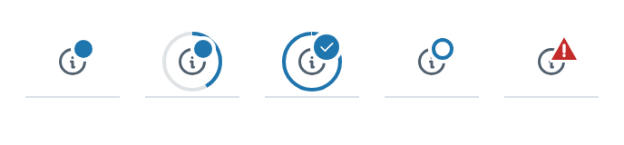
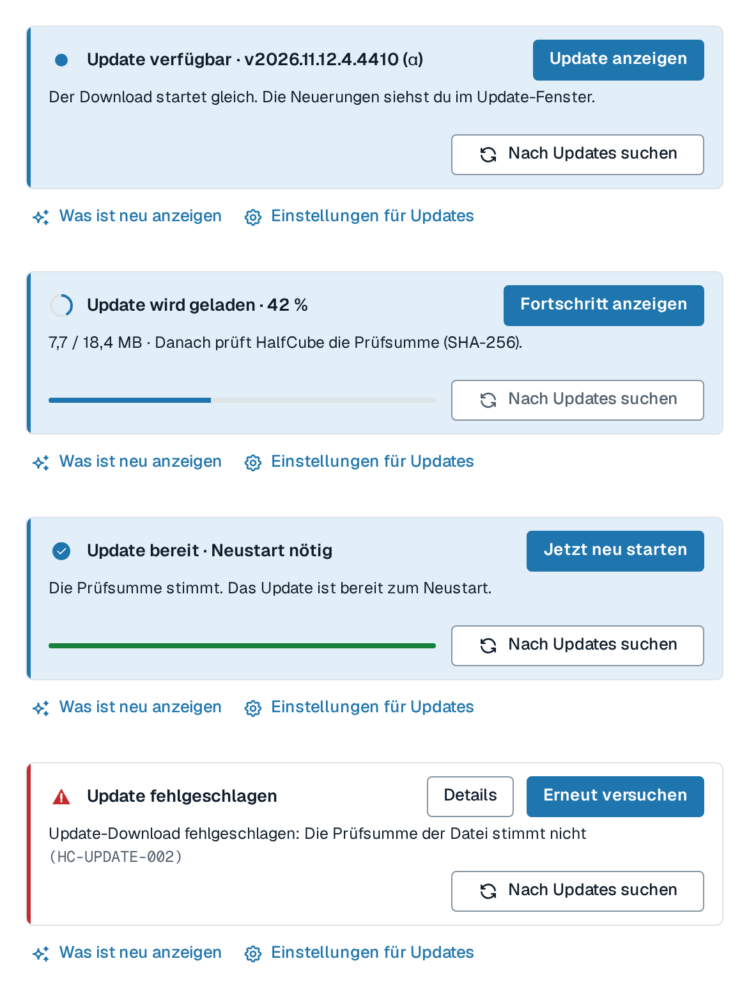
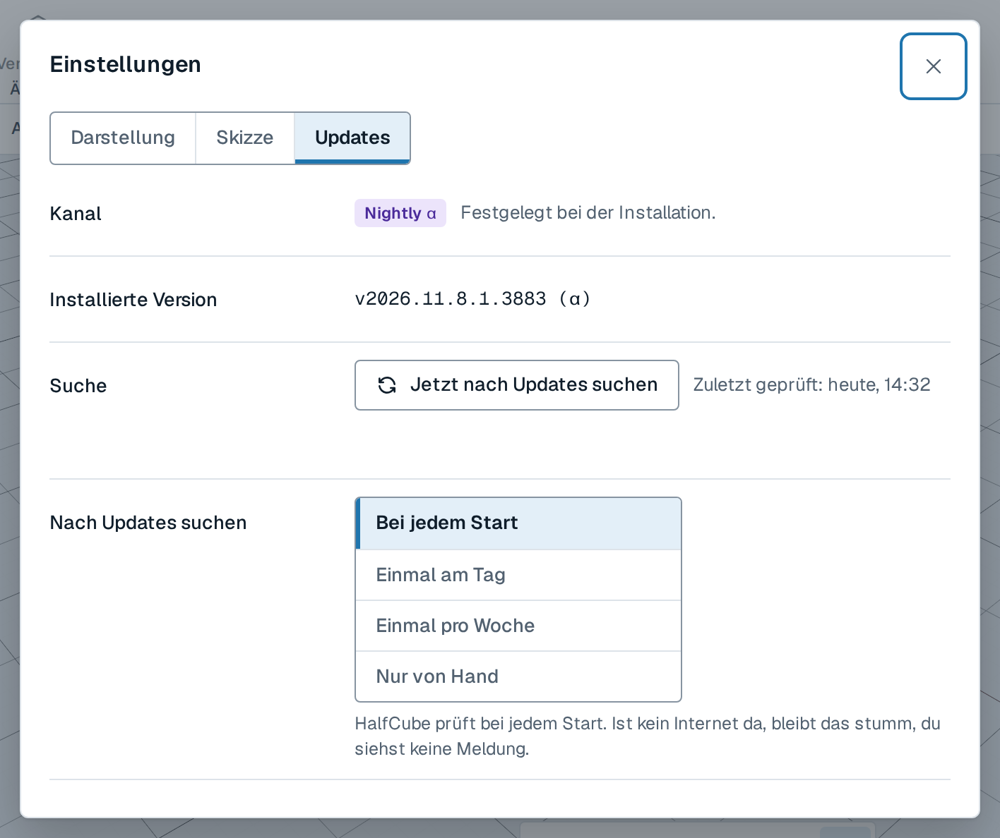
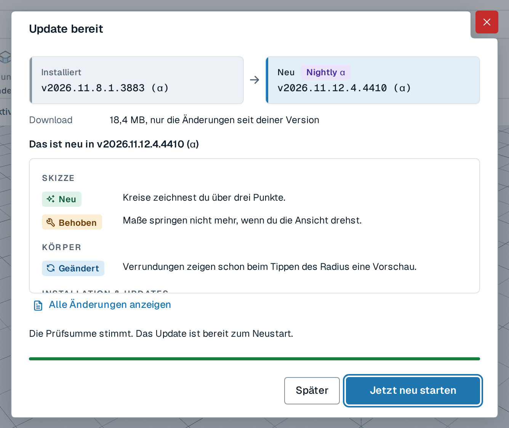
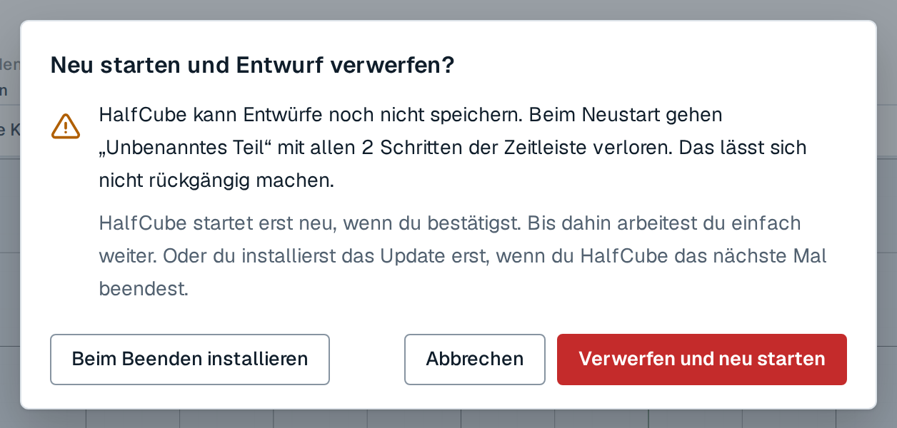
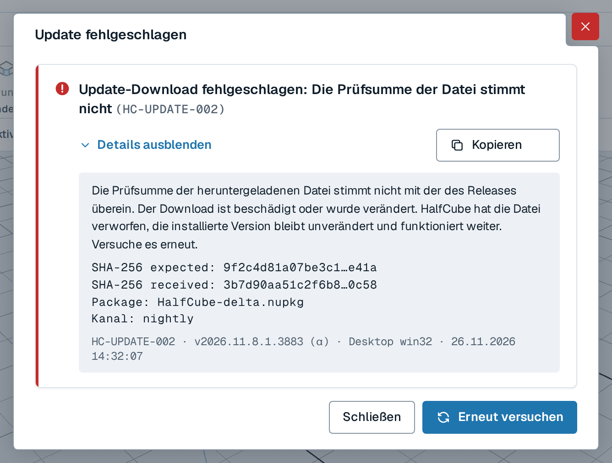
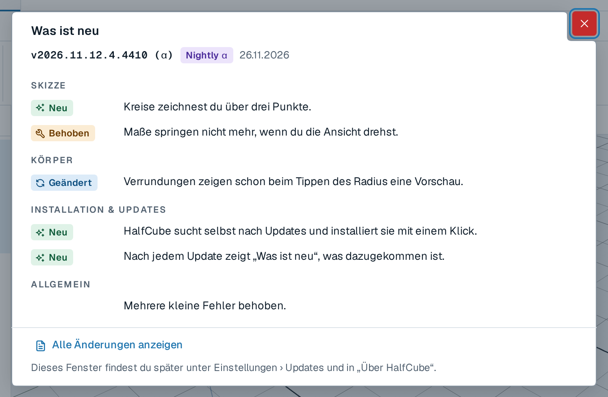
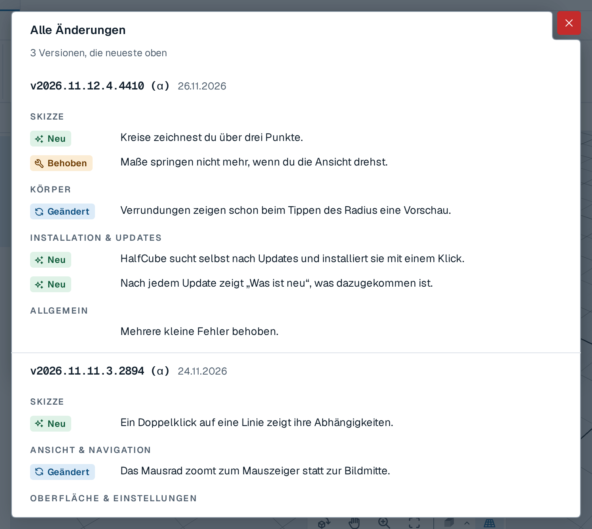

# 1 Über dieses Handbuch

HalfCube befindet sich in früher Entwicklung. Dieses Handbuch beschreibt, was das Programm heute kann. Es ist noch nicht vollständig und wächst mit dem Programm. Bisher steht hier, wie HalfCube sich selbst aktuell hält und unter welcher Lizenz es steht.

# 2 Updates und „Was ist neu“

Ein **Update** ist eine neuere Version von HalfCube. Das Windows-Programm findet Updates selbst, lädt sie im Hintergrund herunter und installiert sie nach deinem Klick. Du musst keine Installationsdatei suchen.

## 2.1 Wo HalfCube installiert wird

Das Setup installiert HalfCube nur für dein Benutzerkonto, in den Ordner `%LOCALAPPDATA%\HalfCube`. Du brauchst dafür keine Administratorrechte. Updates brauchen sie ebenfalls nicht.

## 2.2 Der Punkt am „i“

In der Titelleiste von HalfCube steht rechts ein „i“. Es öffnet das Fenster „Über HalfCube“. Wenn es etwas zu Updates zu sagen gibt, zeigt das „i“ ein kleines Zeichen an seiner oberen rechten Ecke. Das „i“ selbst bleibt gleich groß. Der Hinweistext erscheint, wenn du mit der Maus auf das „i“ zeigst. Abbildung 1 zeigt das „i“ mit dem Punkt für „Update verfügbar“.

| Zeichen am „i“ | Bedeutung | Hinweistext |
|---|---|---|
| Kein Zeichen | Nichts Neues. | – |
| Ausgefüllter Punkt | Ein Update ist verfügbar. | Info · Update verfügbar |
| Dünner Ring, der sich füllt, plus Punkt | Das Update wird geladen. | Info · Update wird geladen 42 % |
| Ring mit Haken | Das Update ist geladen und geprüft. Es fehlt nur noch der Neustart. | Info · Update bereit |
| Leerer Ring | Das Update wird installiert, wenn du HalfCube beendest. | Info · Update wird beim Beenden installiert |
| Warndreieck | Die Suche von Hand oder der Download ist fehlgeschlagen. | Info · Update-Suche fehlgeschlagen oder Info · Update fehlgeschlagen |

Abbildung 2 zeigt die Zeichen von links nach rechts in der Reihenfolge der Tabelle: Punkt, Ring mit Punkt, Ring mit Haken, leerer Ring, Warndreieck.

Das Warndreieck bleibt, bis eine Suche oder ein Download gelingt. Schlägt eine Suche fehl, die HalfCube von selbst gestartet hat, zum Beispiel weil du kein Internet hast, zeigt HalfCube nichts an.

## 2.3 So suchst du nach Updates

HalfCube sucht auch von selbst (siehe Abschnitt 2.4). Du kannst jederzeit selbst suchen:

1. Klicke in der Titelleiste auf das „i“. Das Fenster „Über HalfCube“ öffnet sich auf dem Reiter „Info“.
2. Oben steht die Karte „Updates“. Klicke dort auf **Nach Updates suchen**. Der Knopf ist immer da.
3. Warte einen Moment. Während der Suche dreht sich ein kleiner Kreis im Knopf.

Die Karte zeigt danach, was HalfCube gefunden hat:

- **HalfCube ist aktuell:** Du hast die neueste Version. Darunter steht, wann zuletzt geprüft wurde.
- **Update verfügbar:** Es gibt eine neuere Version. Der Download startet von allein (siehe Abschnitt 2.5).
- **Update-Suche fehlgeschlagen:** Siehe Abschnitt 2.8.

Unter der Karte stehen zwei Links: **Was ist neu anzeigen** und **Einstellungen für Updates**. Abbildung 3 zeigt die Karte in vier Zuständen: Update verfügbar, Update wird geladen, Update bereit und fehlgeschlagen.

## 2.4 Wie oft HalfCube nach Updates sucht

Standardmäßig sucht HalfCube bei jedem Start. So änderst du das:

1. Klicke in der Titelleiste auf das Zahnrad. Die Einstellungen öffnen sich.
2. Wechsle auf den Reiter **Updates**.
3. Wähle bei **Nach Updates suchen** eine Möglichkeit:

| Auswahl | Was HalfCube tut |
|---|---|
| Bei jedem Start | Prüft nach jedem Start. Das ist die Voreinstellung. |
| Einmal am Tag | Prüft beim Start, aber höchstens einmal pro Tag. |
| Einmal pro Woche | Prüft beim Start, aber höchstens einmal pro Woche. |
| Nur von Hand | Prüft nie von selbst. |

Abbildung 4 zeigt den Reiter mit der Voreinstellung.

Bei jeder Auswahl funktionieren **Jetzt nach Updates suchen** (im Reiter „Updates“) und **Nach Updates suchen** (in „Über HalfCube“) immer.

Der Reiter zeigt außerdem:

- den **Kanal** deiner Installation. Er wird bei der Installation festgelegt und lässt sich hier nicht ändern. Die Kanäle sind „Nightly“, „Beta“ und „Release“. Du bekommst nur Updates aus deinem Kanal.
- die **installierte Version** und wann zuletzt geprüft wurde.

> [!HINWEIS]
> Bei der Suche fragt HalfCube den Update-Server auf GitHub nach der Liste der Versionen. HalfCube sendet dabei weder deine Entwürfe noch persönliche Angaben. Das ist eine allgemeine Eigenschaft jedes Internetabrufs: Der Server, der die Anfrage beantwortet, sieht die Internetadresse deines Anschlusses. Auf deinem Rechner speichert HalfCube nur die Einstellung und den Zeitpunkt der letzten Suche.

## 2.5 Was passiert, wenn ein Update gefunden wird

Wenn eine Suche ein Update findet, lädt HalfCube es **sofort im Hintergrund** herunter. Du arbeitest währenddessen normal weiter. Du musst nichts anklicken.

1. HalfCube lädt nur die **Änderungen** zwischen deiner Version und der neuen. Das ist meist wenig. Nur wenn das nicht geht, lädt es das vollständige Paket.
2. Danach prüft HalfCube die Datei mit einer **Prüfsumme** (SHA-256). Eine Prüfsumme ist ein Fingerabdruck der Datei. Er zeigt, dass sie vollständig ist und nicht verändert wurde.
3. Erst wenn die Prüfsumme stimmt, zeigt HalfCube „Update bereit“.

Du siehst den Fortschritt am Ring um das „i“ und in der Karte „Updates“. Dort kannst du **Fortschritt anzeigen** wählen. Das Fenster „Update“ öffnet sich. Es zeigt:

- links deine **installierte** Version, rechts die **neue**, jeweils mit dem Kanal,
- die Größe des Downloads und ob es nur die Änderungen sind,
- unter der Überschrift „Das ist neu in …“ mit der Versionsnummer die **Neuerungen der neuen Version** als Liste zum Blättern, nach Bereichen geordnet,
- darunter den Link **Alle Änderungen anzeigen** (siehe Abschnitt 2.9).

Abbildung 5 zeigt das Fenster, wenn das Update bereit ist.

Mit **Später** schließt du das Fenster. Der Download läuft weiter.

> [!HINWEIS]
> Ein geladenes Update wird **nie von allein** installiert, auch nicht beim nächsten Start. Es wartet, bis du es selbst auslöst.

## 2.6 Das Update installieren

Wenn das „i“ den Ring mit Haken zeigt, ist das Update bereit. Dir bleiben zwei Wege.

**Jetzt neu starten:**

1. Klicke in der Karte „Updates“ auf **Jetzt neu starten**. Du findest den Knopf auch im Fenster „Update“.
2. Ist in HalfCube ein Entwurf mit Schritten in der Zeitleiste offen, erscheint eine Warnung. HalfCube kann Entwürfe noch nicht speichern, sie gehen beim Neustart verloren. Die Warnung nennt den Entwurf und die Zahl der Schritte.
3. Wähle in der Warnung (siehe Abbildung 6):
   - **Verwerfen und neu starten:** HalfCube schließt sich, installiert das Update und startet neu. Der offene Entwurf ist weg.
   - **Beim Beenden installieren:** Du arbeitest weiter. Das Update wird installiert, sobald du HalfCube beendest.
   - **Abbrechen:** Nichts passiert. Du arbeitest weiter.
4. Ist kein Entwurf mit Schritten offen, erscheint keine Warnung. HalfCube startet sofort neu.

**Beim Beenden installieren:**

1. Wähle in der Warnung **Beim Beenden installieren**.
2. Das „i“ zeigt jetzt einen leeren Ring. In der Karte steht „Wird beim Beenden installiert“.
3. Beende HalfCube wie gewohnt. Das Update wird danach installiert. Beim nächsten Start läuft die neue Version.

Du kannst es dir anders überlegen: Klicke in der Karte „Updates“ auf **Vormerkung aufheben**. Das Update bleibt dann „bereit“.

> [!TIPP]
> Solange HalfCube Entwürfe nicht speichern kann, geht beim Neustart der offene Entwurf verloren. Entscheide dich deshalb für „Beim Beenden installieren“, wenn du gerade an etwas arbeitest.

## 2.7 Wenn du länger nicht aktualisiert hast

Hast du HalfCube länger nicht aktualisiert, ist das kein Problem. Du bekommst direkt die neueste Version, nicht eine Version nach der anderen. Das Fenster „Update“ zeigt, was in dieser neuesten Version neu ist. Was früher dazukam, siehst du über den Link **Alle Änderungen anzeigen**.

## 2.8 Wenn etwas schiefgeht

Bei einem Fehler zeigt HalfCube eine Meldung mit einem Fehlercode. Die installierte Version bleibt unverändert und arbeitet weiter. Klicke in der Karte auf **Details**, um die vollständige Meldung zu sehen. Mit **Kopieren** übernimmst du sie in die Zwischenablage, zum Beispiel für eine Fehlermeldung an die Entwickler. Abbildung 7 zeigt die Meldung nach einem Prüfsummenfehler.

| Code | Was passiert ist | Was du tun kannst |
|---|---|---|
| HC-UPDATE-001 | Die Suche ist fehlgeschlagen. Der Update-Server hat nicht geantwortet oder seine Antwort war nicht lesbar. | Prüfe Internetverbindung, Firewall und Proxy. Klicke auf **Erneut versuchen** oder **Nach Updates suchen**. |
| HC-UPDATE-002 | Die Prüfsumme der geladenen Datei stimmt nicht. Die Datei ist beschädigt oder wurde verändert. HalfCube verwendet sie nicht. Sie bleibt als unfertige Datei liegen, und der nächste erfolgreiche Download ersetzt sie. Die installierte Version bleibt unverändert. | Klicke auf **Erneut versuchen**. HalfCube fragt dann zuerst den Update-Server neu. |
| HC-UPDATE-003 | Der Download wurde unterbrochen oder die Datei ließ sich nicht speichern. | Prüfe Internetverbindung und freien Speicherplatz. Klicke auf **Erneut versuchen**. |
| HC-UPDATE-004 | Das geladene Update ließ sich nicht anwenden. HalfCube konnte die Installation nicht starten. | Versuche den Neustart noch einmal oder wähle **Beim Beenden installieren**. |

Nach einem fehlgeschlagenen Download versucht HalfCube es bei der nächsten fälligen Suche von selbst noch einmal.

**Erneut versuchen** fragt zuerst den Update-Server neu und lädt dann das, was er jetzt anbietet. Ein inzwischen repariertes Update wird geladen. Gibt es ein noch neueres, lädt HalfCube dieses. Hat der Server das Update zurückgezogen, zeigt HalfCube „HalfCube ist aktuell“. Ohne Internetverbindung erscheint der Fehler HC-UPDATE-001.

### Wenn ein neueres Update nicht geladen werden kann

Manchmal liegt schon ein Update bereit, und eine spätere Suche findet ein noch neueres. Scheitert der Download dieses neueren Updates, geht das bereite Update nicht verloren. Du kannst es weiterhin installieren.

HalfCube zeigt dann einen zusätzlichen Hinweis:

- In der Karte „Updates“ wird die Karte um eine Zeile am unteren Rand länger. Dort steht zum Beispiel: „Neueres Update v2026.11.12.4.4410 (α) konnte nicht geladen werden. (HC-UPDATE-003)“. Der Text in Klammern ist der Fehlercode.
- Im Fenster „Update“ steht dieselbe Zeile über den Knöpfen.

Die Zeile hat zwei Knöpfe:

- **Details** zeigt die vollständige Fehlermeldung zum Kopieren.
- **Erneut versuchen** fragt zuerst den Update-Server neu. Ist das neuere Update repariert, wird es geladen. Gibt es ein noch neueres, wird stattdessen dieses geladen. Ist das neuere Update zurückgezogen, verschwindet der Hinweis, und das bereite Update bleibt. Ohne Internetverbindung zeigt der Hinweis den Fehlercode HC-UPDATE-001, und das bereite Update bleibt bereit.

Der Hinweis verschwindet auch von selbst, sobald eine Suche das neuere Update nicht mehr findet. Das bereite Update bleibt erhalten. **Jetzt neu starten** installiert es wie gewohnt.

### Wenn HalfCube keine Updates sucht

In diesen Fällen sucht HalfCube nicht. Der Reiter „Updates“ der Einstellungen nennt den Grund:

- **Entwicklungsversion:** „Diese Entwicklungsversion sucht nicht nach Updates.“
- **Nicht aus der Installation gestartet:** „HalfCube läuft hier nicht aus der Installation und sucht deshalb nicht nach Updates.“ Installiere HalfCube mit dem Setup.
- **Portable Kopie:** „Eine portable Kopie sucht nicht nach Updates.“

## 2.9 „Was ist neu“ und „Alle Änderungen“

Das Fenster „Was ist neu“ zeigt, was in der Version neu ist, die du gerade benutzt. Es zeigt nur diese eine Version. Oben stehen die Versionsnummer, eine Marke für den Kanal (Nightly oder Beta; eine Release-Version hat keine Marke) und das Datum des Eintrags, zum Beispiel 27.11.2026. Darunter sind die Änderungen nach Bereichen geordnet, zum Beispiel „Skizze“ oder „Körper“. Eine farbige Marke vor jeder Zeile nennt die Art der Änderung: Neu, Geändert, Behoben, Sicherheit, Entfernt oder Veraltet. Ist der Eintrag lang, blätterst du im Fenster.

**Von selbst:** Nach einem Update öffnet sich das Fenster beim ersten Start der neuen Version (siehe Abbildung 8).

**Schließen:** Das Schließen-Kreuz, die Taste Esc oder ein Klick neben das Fenster schließt es. Danach öffnet es sich für diese Version nicht mehr von selbst.

**Es öffnet sich nicht**, wenn du HalfCube zum ersten Mal installierst, solange das Willkommensfenster offen ist oder wenn der Eintrag der neuen Version nichts enthält, was du bemerkst.

**Später ansehen:**

- Klicke im Fenster „Über HalfCube“ auf **Was ist neu anzeigen**, oder
- öffne die Einstellungen, wechsle auf den Reiter **Updates** und wähle **Was ist neu**.

Die Einträge erscheinen in deiner Sprache. Sie sind in HalfCube eingebaut und brauchen keine Internetverbindung.

### Alle Änderungen

Ältere Versionen zeigt das Fenster „Alle Änderungen“. Du erreichst es so:

1. Öffne das Fenster „Was ist neu“ oder das Fenster „Update“.
2. Klicke auf den Link **Alle Änderungen anzeigen**.

Oben nennt das Fenster, wie viele Versionen es enthält. Darunter steht jede Version, die **neueste zuerst**. Jede hat ihre Versionsnummer, das Datum und ihre Änderungen, nach Bereichen geordnet und mit den farbigen Marken. Abbildung 9 zeigt es. Du blätterst im Fenster. Das Schließen-Kreuz, die Taste Esc oder ein Klick neben das Fenster schließt es.

Öffnest du das Fenster aus „Was ist neu“, zeigt es alle Versionen deines Kanals, die in HalfCube eingebaut sind. Dafür braucht es keine Internetverbindung. Öffnest du es aus dem Fenster „Update“, zeigt es die Versionen aus der Beschreibung des neuen Updates.

# 3 Lizenz und mitgelieferte Bausteine

HalfCube besteht nicht nur aus eigenem Code. Es enthält **Bausteine** anderer Projekte, zum Beispiel für die Geometrie. Jeder Baustein hat seine eigene **Lizenz**. Eine Lizenz ist die Erlaubnis des Urhebers, ein Werk unter bestimmten Bedingungen zu benutzen. Dieses Kapitel sagt dir, unter welcher Lizenz HalfCube steht, welche Bausteine dazugehören und wo du die vollständigen Texte findest.

## 3.1 Die Lizenz von HalfCube

HalfCube steht unter der **PolyForm Shield License 1.0.0**. Die Lizenz erlaubt die kostenlose Nutzung, privat und geschäftlich, sowie Änderungen für den eigenen Gebrauch. Du kannst zum Beispiel Teile verkaufen, die du mit HalfCube entworfen hast. Ausgenommen ist das Anbieten von Produkten, die mit HalfCube im Wettbewerb stehen. Es gibt keine Gewährleistung.

Der Quelltext von HalfCube ist öffentlich. Trotzdem nennt HalfCube sich nicht „Open Source“, denn diese Bezeichnung hat eine feste Bedeutung, die die Lizenz nicht erfüllt. Das richtige Wort ist „quelloffen“.

> [!HINWEIS]
> Das ist eine einfache Zusammenfassung, keine Rechtsberatung. Maßgeblich ist der Lizenztext.

## 3.2 Wo du die Texte findest

Alle Lizenzen liegen in HalfCube selbst. Du brauchst dafür keine Internetverbindung.

1. Klicke in der Titelleiste auf das „i“. Das Fenster „Über HalfCube“ öffnet sich auf dem Reiter **Info**.
2. Im Abschnitt **Lizenz** steht die Zusammenfassung. Klicke auf **Lizenztext anzeigen**, um den vollständigen Text der PolyForm Shield License zu lesen.
3. Klicke auf **NOTICE-Datei ansehen**, um die Datei `NOTICE` zu lesen. Sie enthält die Pflichthinweise, die Zusatzerlaubnis für die mitgelieferten Bibliotheken (siehe Abschnitt 3.3) und den Hinweis zu den früheren Versionen unter der GPL.
4. Klicke auf **Quelltext auf GitHub**, um den öffentlichen Quelltext zu öffnen.

Alle Bausteine stehen auf dem Reiter **Lizenzen**:

1. Öffne „Über HalfCube“ und wechsle auf den Reiter **Lizenzen**. Du erreichst ihn auch mit dem Link **Lizenzen** unter dem Satz „Enthält … unter der LGPL-2.1“ auf dem Reiter „Info“.
2. Die Liste ist nach Bereichen geordnet: **Dieses Programm**, **Konstruktionskern**, **Oberfläche** und **Programmrahmen**. Schreibe einen Namen in das Feld **Bausteine durchsuchen**, um schneller zu finden, was du suchst.
3. Klicke auf einen Baustein. Du siehst seine **Lizenz**, den **Urheberrechtshinweis**, die **Quelle** und darunter den **Lizenztext**.
4. Mit **Alle Bausteine** gehst du zurück zur Liste.

Die Liste zeigt nur die Bausteine, die in der Version enthalten sind, die du benutzt.

## 3.3 Die wichtigsten Bausteine

| Baustein | Wofür HalfCube ihn braucht | Lizenz |
|---|---|---|
| Open CASCADE Technology (OCCT) | Der Geometriekern. Er berechnet die Körper. | LGPL-2.1 mit der Ausnahme von Open CASCADE |
| planegcs | Der Skizzen-Löser aus FreeCAD. Er hält Maße und Abhängigkeiten in der Skizze ein. | LGPL-2.1 |
| Eigen | Rechenbibliothek für den Skizzen-Löser. | MPL-2.0 |
| React, three.js und weitere | Oberfläche und 3D-Ansicht. | meist MIT |
| Geist und Geist Mono | Die Schriften von HalfCube. | SIL Open Font License 1.1 |
| Electron, Chromium, Velopack, Microsoft-Visual-C++-Laufzeit | Rahmen des Windows-Programms. | verschieden, siehe Reiter „Lizenzen“ |

Die vollständige Liste mit den genauen Lizenzen steht auf dem Reiter „Lizenzen“.

### Hinweis zu Open CASCADE Technology

HalfCube benutzt und basiert auf Funktionen der Software **Open CASCADE Technology** (OCCT, https://dev.opencascade.org). OCCT steht unter der GNU Lesser General Public License, Version 2.1 (LGPL-2.1), mit der Open-CASCADE-Ausnahme (Version 1.0). Diese Ausnahme verlangt, dass die Begleitdokumentation darauf hinweist. Das ist dieser Hinweis. Der Lizenztext von OCCT steht auf dem Reiter „Lizenzen“ unter dem Baustein „Open CASCADE Technology (OCCT)“.

Die LGPL erlaubt es dir, die mitgelieferten Bibliotheken zu ändern und HalfCube mit der geänderten Fassung zu benutzen. Dafür gibt die Datei `NOTICE` eine Zusatzerlaubnis: Du darfst HalfCube für den eigenen Gebrauch ändern und es zurückentwickeln, soweit das zur Fehlersuche an solchen Änderungen nötig ist. Den Quelltext findest du über **Quelltext auf GitHub**.

## 3.4 Name und Logo

Der Name „HalfCube“ und das Logo gehören nicht zur Lizenz des Codes. Wie du sie verwenden darfst, steht in der Datei `TRADEMARKS.md` im öffentlichen Quelltext (siehe Abschnitt 3.2, Schritt 4).
