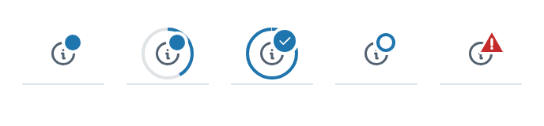
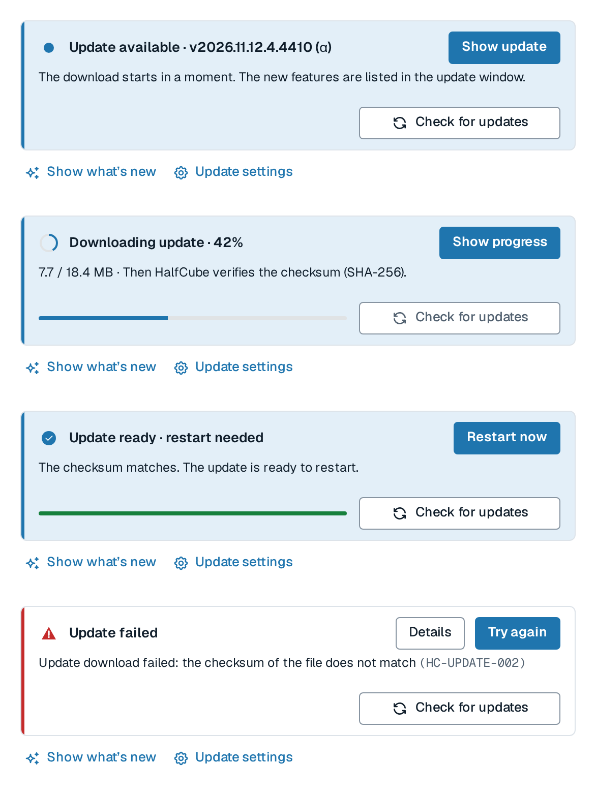
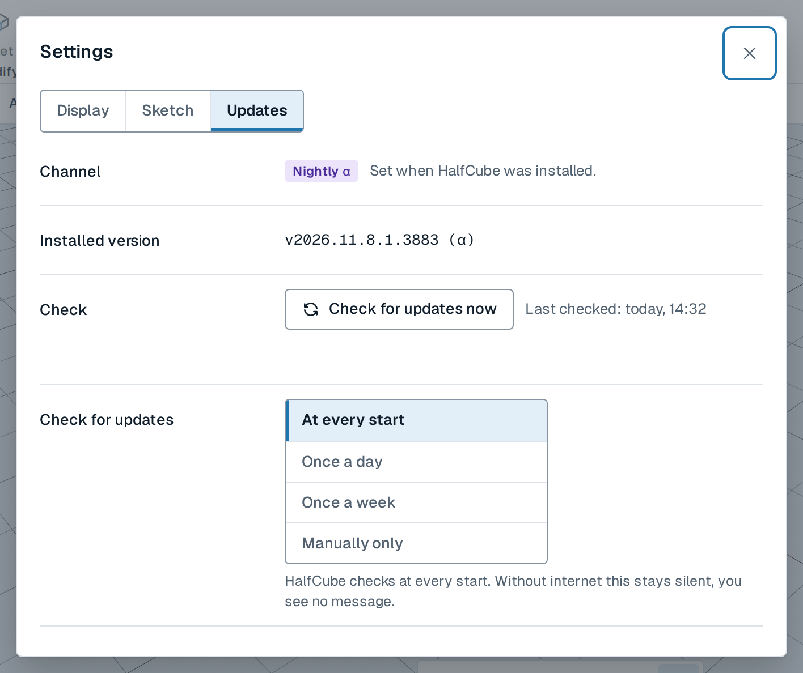
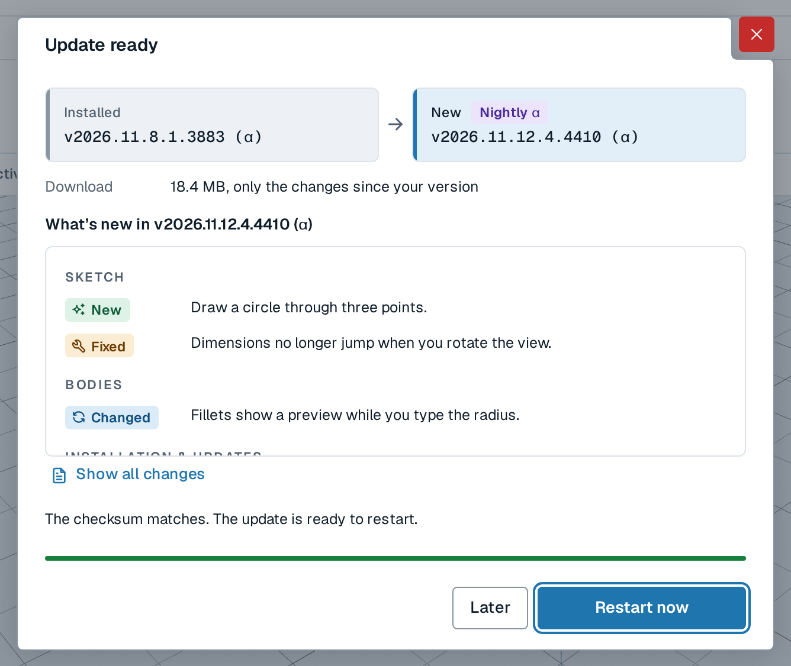
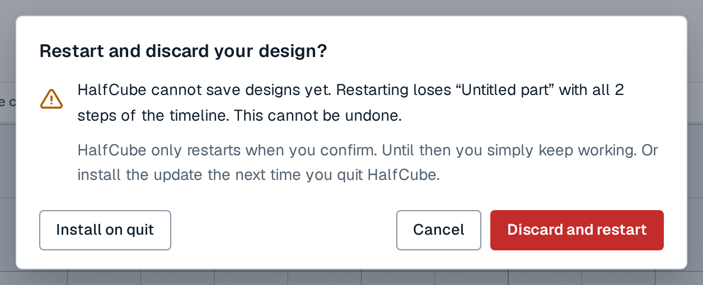
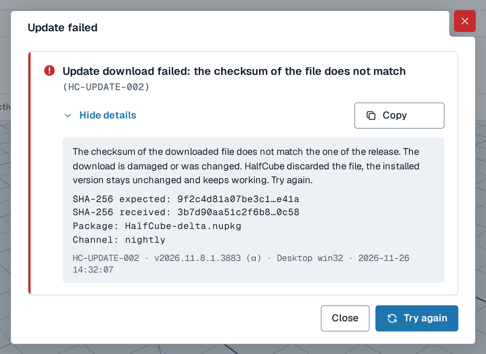
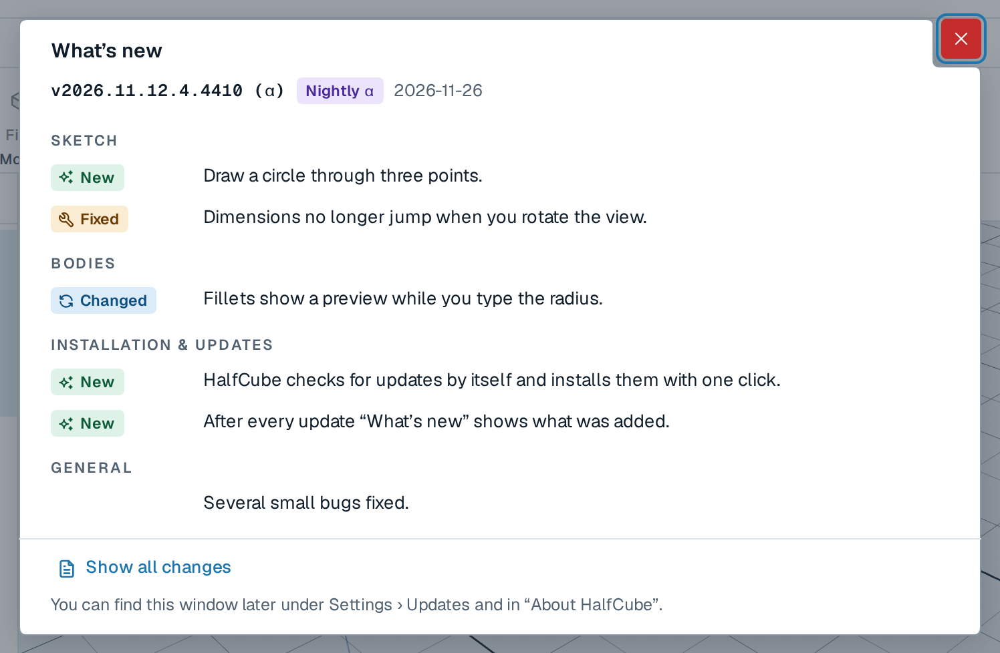
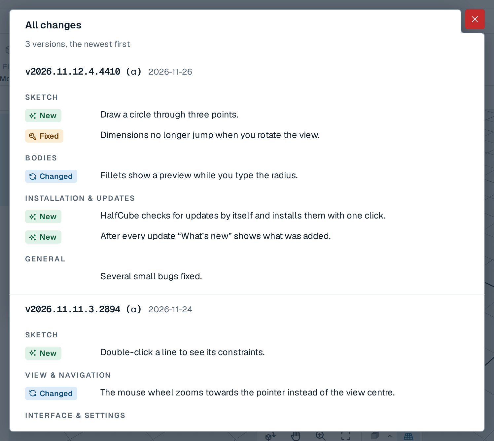

# 1 About this handbook

HalfCube is in early development. This handbook describes what the program can do today. It is not complete yet and grows with the program. So far it covers how HalfCube keeps itself up to date.

# 2 Updates and “What’s new”

An **update** is a newer version of HalfCube. The Windows program finds updates by itself, downloads them in the background and installs them after your click. You do not have to look for an installer file.

## 2.1 Where HalfCube is installed

The setup installs HalfCube for your user account only, into the folder `%LOCALAPPDATA%\HalfCube`. You do not need administrator rights for this. Updates do not need them either.

## 2.2 The dot on the “i”

On the right of the title bar of HalfCube there is an “i”. It opens the window “About HalfCube”. When there is something to say about updates, the “i” shows a small mark at its top right corner. The “i” itself stays the same size. The hint text appears when you point at the “i” with the mouse. Figure 1 shows the “i” with the dot for “Update available”.

| Mark on the “i” | Meaning | Hint text |
|---|---|---|
| No mark | Nothing new. | – |
| Filled dot | An update is available. | Info · Update available |
| Thin ring that fills up, plus dot | The update is downloading. | Info · Downloading update 42% |
| Ring with a check mark | The update is downloaded and verified. Only the restart is left. | Info · Update ready |
| Empty ring | The update installs when you quit HalfCube. | Info · Update installs when you quit |
| Warning triangle | A manual check or the download failed. | Info · Update check failed or Info · Update failed |

Figure 2 shows the marks from left to right in the order of the table: dot, ring with dot, ring with check mark, empty ring, warning triangle.

The warning triangle stays until a check or download succeeds. If a check that HalfCube started by itself fails, for example because you have no internet, HalfCube shows nothing.

## 2.3 How to check for updates

HalfCube also checks by itself (see section 2.4). You can check yourself at any time:

1. Click the “i” in the title bar. The window “About HalfCube” opens on the tab “Info”.
2. At the top is the card “Updates”. Click **Check for updates** there. The button is always there.
3. Wait a moment. While HalfCube checks, a small circle turns inside the button.

Afterwards the card shows what HalfCube found:

- **HalfCube is up to date:** You have the newest version. Below it you see when HalfCube last checked.
- **Update available:** A newer version exists. The download starts by itself (see section 2.5).
- **Update check failed:** See section 2.8.

Below the card are two links: **Show what’s new** and **Update settings**. Figure 3 shows the card in four states: update available, downloading, update ready and failed.

## 2.4 How often HalfCube checks for updates

By default HalfCube checks at every start. To change this:

1. Click the gear in the title bar. The settings open.
2. Switch to the tab **Updates**.
3. Under **Check for updates**, choose one option:

| Choice | What HalfCube does |
|---|---|
| At every start | Checks after every start. This is the default. |
| Once a day | Checks at start, but at most once a day. |
| Once a week | Checks at start, but at most once a week. |
| Manually only | Never checks by itself. |

Figure 4 shows the tab with the default.

With every choice, **Check for updates now** (on the tab “Updates”) and **Check for updates** (in “About HalfCube”) always work.

The tab also shows:

- the **channel** of your installation. It is set when you install and cannot be changed here. The channels are “Nightly”, “Beta” and “Release”. You only get updates from your channel.
- the **installed version** and when HalfCube last checked.

> [!NOTE]
> When it checks, HalfCube asks the update server on GitHub for the list of versions. HalfCube sends neither your designs nor personal details. This is a general property of every internet request: the server that answers it sees the internet address of your connection. On your computer HalfCube stores only the setting and the time of the last check.

## 2.5 What happens when an update is found

When a check finds an update, HalfCube downloads it **right away in the background**. You keep working as usual. You do not have to click anything.

1. HalfCube downloads only the **changes** between your version and the new one. That is usually little. Only when this is not possible does it download the complete package.
2. Then HalfCube checks the file with a **checksum** (SHA-256). A checksum is a fingerprint of the file. It shows that the file is complete and unchanged.
3. Only when the checksum matches does HalfCube show “Update ready”.

You see the progress on the ring around the “i” and in the card “Updates”. There you can choose **Show progress**. The window “Update” opens. It shows:

- your **installed** version on the left and the **new** one on the right, each with its channel,
- the size of the download and whether it is only the changes,
- under the heading “What’s new in …” with the version number, the **new features of the new version** as a list you can scroll, sorted by area,
- below it the link **Show all changes** (see section 2.9).

Figure 5 shows the window when the update is ready.

**Later** closes the window. The download goes on.

> [!NOTE]
> A downloaded update is **never installed by itself**, not even at the next start. It waits until you start it yourself.

## 2.6 Installing the update

When the “i” shows the ring with a check mark, the update is ready. You have two ways.

**Restart now:**

1. Click **Restart now** in the card “Updates”. You also find the button in the window “Update”.
2. If a design with steps in its timeline is open, a warning appears. HalfCube cannot save designs yet, so they are lost on restart. The warning names the design and the number of steps.
3. In the warning (see Figure 6), choose:
   - **Discard and restart:** HalfCube closes, installs the update and starts again. The open design is gone.
   - **Install on quit:** You keep working. The update is installed as soon as you quit HalfCube.
   - **Cancel:** Nothing happens. You keep working.
4. If no design with steps is open, no warning appears. HalfCube restarts at once.

**Install on quit:**

1. In the warning, choose **Install on quit**.
2. The “i” now shows an empty ring. The card says “Installs when you quit”.
3. Quit HalfCube as usual. The update is installed afterwards. The next time you start, the new version runs.

You can change your mind: click **Cancel scheduled install** in the card “Updates”. The update then stays “ready”.

> [!TIP]
> As long as HalfCube cannot save designs, the open design is lost on restart. If you are in the middle of something, choose “Install on quit”.

## 2.7 If you have not updated for a while

If you have not updated HalfCube for a while, that is no problem. You get the newest version directly, not one version after another. The window “Update” shows what is new in this newest version. What was added earlier, you see through the link **Show all changes**.

## 2.8 When something goes wrong

When an error occurs, HalfCube shows a message with an error code. The installed version stays unchanged and keeps working. Click **Details** in the card to see the complete message. **Copy** puts it on the clipboard, for example for a report to the developers. Figure 7 shows the message after a checksum error.

| Code | What happened | What you can do |
|---|---|---|
| HC-UPDATE-001 | The check failed. The update server did not answer, or its answer was unreadable. | Check your internet connection, firewall and proxy. Click **Try again** or **Check for updates**. |
| HC-UPDATE-002 | The checksum of the downloaded file does not match. The file is damaged or was changed. HalfCube does not use it. It stays behind as an unfinished file, and the next successful download replaces it. The installed version stays unchanged. | Click **Try again**. HalfCube then first asks the update server again. |
| HC-UPDATE-003 | The download was interrupted, or the file could not be saved. | Check your internet connection and free disk space. Click **Try again**. |
| HC-UPDATE-004 | The downloaded update could not be applied. HalfCube could not start the installation. | Try the restart again, or choose **Install on quit**. |

After a failed download, HalfCube tries again by itself at the next due check.

**Try again** first asks the update server again and then downloads what it offers now. An update that has been repaired in the meantime is downloaded. If there is an even newer one, HalfCube downloads that one. If the server has withdrawn the update, HalfCube shows “HalfCube is up to date”. Without an internet connection the error HC-UPDATE-001 appears.

### When a newer update cannot be downloaded

Sometimes an update is already ready and a later check finds an even newer one. If the download of that newer update fails, the ready update is not lost. You can still install it.

HalfCube then shows an extra notice:

- In the card “Updates”, the card grows by one row at its bottom edge. It says, for example: “The newer update v2026.11.12.4.4410 (α) could not be downloaded. (HC-UPDATE-003)”. The text in brackets is the error code.
- In the window “Update”, the same row appears above the buttons.

The row has two buttons:

- **Details** shows the complete error message, which you can copy.
- **Try again** first asks the update server again. If the newer update has been repaired, it is downloaded. If there is an even newer one, that one is downloaded instead. If the newer update has been withdrawn, the notice disappears and the ready update stays. Without an internet connection the notice shows the error code HC-UPDATE-001, and the ready update stays ready.

The notice also disappears by itself as soon as a check no longer finds the newer update. The ready update is kept. **Restart now** installs it as usual.

### When HalfCube does not check for updates

In these cases HalfCube does not check. The tab “Updates” in the settings names the reason:

- **Development build:** “This development build does not check for updates.”
- **Not started from the installation:** “HalfCube is not running from its installation here, so it does not check for updates.” Install HalfCube with the setup.
- **Portable copy:** “A portable copy does not check for updates.”

## 2.9 “What’s new” and “All changes”

The window “What’s new” shows what is new in the version you are running now. It shows only this one version. At the top are the version number, a badge for the channel (Nightly or Beta; a release version has no badge) and the date of the entry, for example 2026-11-27. Below, the changes are sorted by area, for example “Sketch” or “Bodies”. A coloured badge before each line names the kind of change: New, Changed, Fixed, Security, Removed or Deprecated. If the entry is long, you scroll inside the window.

**By itself:** After an update, the window opens at the first start of the new version (see Figure 8).

**Closing:** The close button, the Esc key or a click next to the window closes it. After that it does not open by itself again for this version.

**It does not open** when you install HalfCube for the first time, while the welcome window is open, or when the entry of the new version contains nothing you would notice.

**Looking at it later:**

- Click **Show what’s new** in the window “About HalfCube”, or
- open the settings, switch to the tab **Updates** and choose **What’s new**.

The entries appear in your language. They are built into HalfCube and need no internet connection.

### All changes

The window “All changes” shows older versions. You reach it like this:

1. Open the window “What’s new” or the window “Update”.
2. Click the link **Show all changes**.

At the top, the window says how many versions it contains. Below, every version is listed, the **newest first**. Each has its version number, its date and its changes, sorted by area and with the coloured badges. Figure 9 shows it. You scroll inside the window. The close button, the Esc key or a click next to the window closes it.

If you open the window from “What’s new”, it shows all versions of your channel that are built into HalfCube. It needs no internet connection for that. If you open it from the window “Update”, it shows the versions from the description of the new update.

## 2.10 The browser version

The browser version has no update function, no dot on the “i” and no card “Updates”. It is always current when you open it. “What’s new” exists there too: through the link in “About HalfCube” and in the settings on the tab “Updates”. It does not open by itself there.
